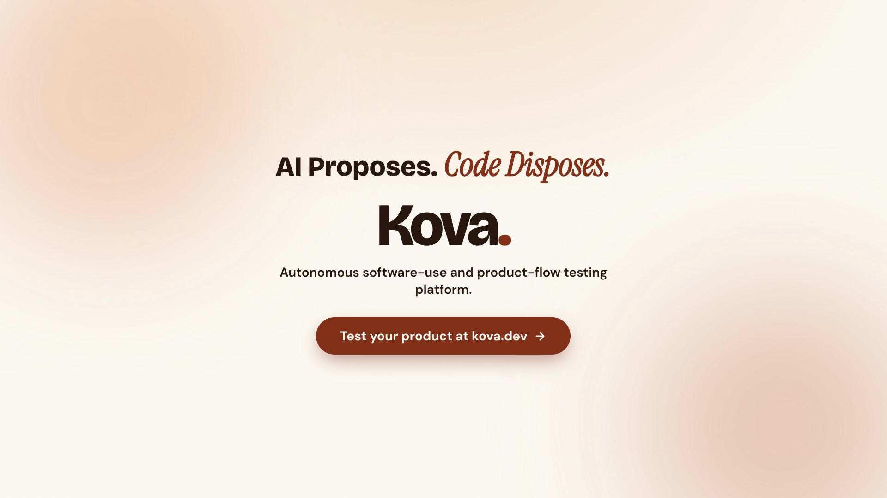
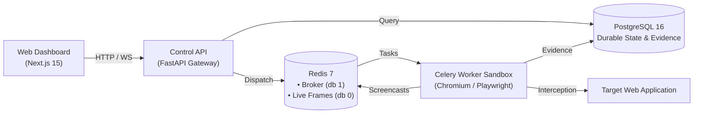

# Kova

> **Autonomous software-use and product-flow testing platform.**
> Give Kova a URL, credentials, and a testing goal. It launches an isolated Playwright browser, explores the application, discovers critical user journeys, executes them step-by-step, and verifies outcomes with cryptographic evidence.

[](LICENSE)
[](backend/pyproject.toml)
[](https://playwright.dev/)
[](https://fastapi.tiangolo.com)
[](https://nextjs.org)

---

<p align="center">
  <a href="brag-output/brag.mp4">
    
  </a>
  <br />
  <em>▶ <b><a href="brag-output/brag.mp4">Watch Kova in Action (18s)</a></b> — Autonomous exploration, modal & obstruction handling, and cryptographic verification.</em>
</p>

---

## What is Kova?

Manual QA and brittle end-to-end scripts break on every UI tweak. Teams waste days maintaining flaky selectors or manually clicking through signup, checkout, and settings flows before every deploy.

**Kova acts as an autonomous user**:
1. **Autonomous Exploration**: Maps routes, forms, interactive buttons, and authentication boundaries without pre-configured scripts.
2. **Journey Synthesis**: Proposes realistic user journeys (e.g. "Register account", "Upgrade subscription", "Invite team member").
3. **Isolated Browser Execution**: Executes journeys inside dedicated, sandboxed Chromium instances managed by background workers.
4. **Honest, Evidence-Backed Verification**: Validates state deterministically via network status, DOM assertions, and cryptographic screenshot hashes. If an outcome cannot be proven, Kova reports `UNVERIFIED` or `BLOCKED`—never a false `PASSED`.

---

## Key Differentiators

| Feature | Generic AI Automation / Fragile Scripts | Kova |
| :--- | :--- | :--- |
| **Execution Architecture** | API server spawns browsers directly, risking crashes and resource exhaustion | **Isolated Celery Workers**: Read-only root filesystem, non-root user, per-job tmpfs, cap-drop sandbox. |
| **Outcome Integrity** | Model hallucinates "Task Completed" without real verification | **AI Proposes, Code Disposes**: Model output validated into strict Pydantic schemas. Only deterministic assertions can mark completion. |
| **Live Observability** | Black-box execution or post-mortem logs | **Live Screencast & Telemetry**: WebSocket viewport frames and SSE progress events stream live to the dashboard. |
| **Egress Security** | Open network access vulnerable to SSRF | **Egress Firewall**: DNS resolved once and IP-pinned; loopback, private subnets (RFC1918), and cloud metadata blocked at the route level. |
| **Human Takeover** | Run aborts completely when 2FA or CAPTCHA appears | **Safe State Machine**: Worker quiesces at action boundary, hands control to human for MFA/2FA, re-observes DOM, and resumes cleanly. |

---

## Architecture Overview



Detailed architectural diagrams, runtime topology, and security invariants are documented in [docs/ARCHITECTURE.md](docs/ARCHITECTURE.md).

---

## Quick Start (Docker Compose)

The fastest way to run Kova is with Docker Compose.

### Prerequisites
- [Docker](https://docs.docker.com/get-docker/) 24.0+ and [Docker Compose](https://docs.docker.com/compose/) v2.

### 1. Clone & Configure
```bash
git clone https://github.com/jayo14/kova.git
cd kova
cp .env.example backend/.env
```

*Note: For local testing, default values in `.env.example` work out of the box with PostgreSQL and Redis.*

### 2. Launch Services
```bash
docker compose up -d --build
```

### 3. Verify Health
```bash
curl -fsS http://localhost:8000/health
```
Expected response:
```json
{"status":"healthy","database":"connected","redis":"connected"}
```

Access Kova:
- **Web Dashboard**: [http://localhost:3000](http://localhost:3000)
- **FastAPI Documentation**: [http://localhost:8000/docs](http://localhost:8000/docs)
- **API Health**: [http://localhost:8000/health](http://localhost:8000/health)

---

## Manual Local Setup

For local Python and Node development without Docker, see the step-by-step [docs/local-setup.md](docs/local-setup.md) for Windows, macOS, and Linux instructions.

```bash
# Backend
cd backend && python3 -m venv .venv
source .venv/bin/activate  # On Windows: .venv\Scripts\activate
pip install -e . && playwright install chromium
alembic upgrade head
uvicorn app.main:app --reload --port 8000

# Worker (separate terminal - default to concurrency=1 on local dev to prevent CPU/memory contention from multiple Chromium instances)
celery -A app.workers.celery_app worker --loglevel=info --concurrency=1

# Frontend (separate terminal)
cd frontend && npm install && npm run dev
```

---

## End-to-End Smoke Test

Verify your local installation with the automated smoke suite:

```bash
./scripts/smoke/run_smoke.sh
```

This verifies:
- AI provider degradation & failover handling
- S3 / object storage fallbacks
- Database readiness retries
- SSRF prevention & private IP blocking
- Sensitive data redaction in execution logs

For manual walkthrough instructions against a real site, consult [docs/smoke-test.md](docs/smoke-test.md).

---

## Documentation Index

- [Architecture & Runtime Topology](docs/ARCHITECTURE.md)
- [Local Setup (Windows, macOS, Linux)](docs/local-setup.md)
- [Troubleshooting & Diagnostics](docs/troubleshooting.md)
- [Development & Contributing](docs/development.md)
- [Smoke Test Procedures](docs/smoke-test.md)
- [Security Policy & SSRF Rules](docs/SECURITY.md)

---

## License

This project is licensed under the MIT License. See [LICENSE](LICENSE) for details.
