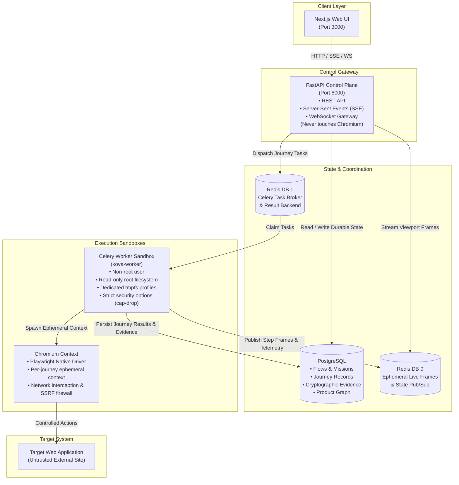
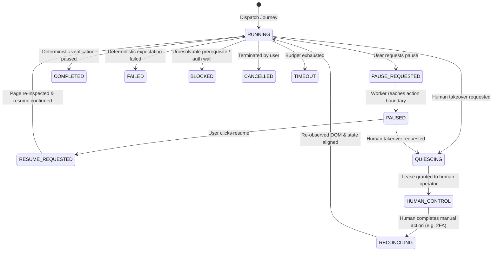

# Kova Architecture

This document provides a technical specification of Kova's runtime topology, execution lifecycle, verification contracts, and security architecture.

---

## 1. Runtime Topology & System Boundaries

Kova enforces a strict separation between the public API gateway and the privileged browser execution workers.



### Component Roles

1. **`kova-api` (Control Gateway)**:
   - Exposes REST endpoints for project management, journey synthesis, and execution dispatching.
   - Streams live browser viewport screencasts to the web dashboard via WebSockets and real-time step events via Server-Sent Events (SSE).
   - **Architectural Invariant**: The API container **never** instantiates Playwright or Chromium. Browser management is exclusively delegated to sandboxed workers.
2. **`kova-worker` (Execution Sandbox)**:
   - Celery worker processes dedicated to browser execution (`app.workers.celery_app`).
   - Each exploration or journey execution initializes a completely isolated Playwright Chromium browser context.
   - Operates with a read-only root filesystem, non-root user (`kova`), dropped Linux capabilities (`cap_drop: ALL`), and per-job ephemeral `tmpfs` directories.
3. **`redis` (Broker & State Pub/Sub)**:
   - **Database 1**: Celery message broker and durable task result backend.
   - **Database 0**: High-throughput pub/sub for real-time JPEG viewport screencasts and ephemeral step telemetry.
4. **`postgres` (Durable State Engine)**:
   - Stores user accounts, organizations, projects, synthesized flows, execution outcomes, step-by-step audit logs, and sha256-hashed screenshot evidence pointers.

---

## 2. Core Architectural Invariants

### Invariant 1: AI Proposes, Deterministic Code Disposes
AI models are treated as untrusted recommendation engines. Model outputs are parsed into strict Pydantic models (`TargetProposal`, `ActionProposal`, `MissionPlan`). Before any browser action is dispatched:
1. Target proposals are resolved against real DOM nodes via deterministic target resolution ladders (`data-testid` → accessible name / role → text → CSS selector).
2. Proposed actions pass through semantic and security validators (`app.engine.ai.validator`).
3. **Only deterministic code can complete a journey**: An execution cannot be marked `COMPLETED` or `PASSED` by model hallucination. An outcome is verified exclusively by deterministic assertions, HTTP status checks, URL verification, and DOM predicates. If proof is missing, the status is marked `UNVERIFIED` or `BLOCKED`.

### Invariant 2: Hostile Target / Untrusted Content Boundary
All web pages explored, emails received, and files downloaded are treated as hostile, untrusted inputs:
- **Prompt Injection Defense**: Text extracted from target pages is quarantined and sanitized before being included in prompt context. Instructions inside DOM text are never executed as system directives.
- **SSRF & DNS Rebinding Protection**: Every network request generated by Chromium passes through Kova's egress evaluator (`app.engine.browser.egress`). Private subnets (`10.0.0.0/8`, `172.16.0.0/12`, `192.168.0.0/16`), loopback (`127.0.0.0/8`), cloud metadata endpoints (`169.254.169.254`), and link-local addresses are rejected at the route level. Safe hostnames are DNS-resolved, and destination IPs are pinned to prevent rebinding attacks.
- **Download Safety**: Browser downloads are restricted to job-scoped temporary directories. Binary executables (`.exe`, `.bat`, `.sh`, `.dll`, `.dmg`, etc.) are blocked and cancelled immediately.

---

## 3. Execution Control & Human Takeover State Machine

Execution state transitions are authoritative and managed in `app.engine.execution.control`:



- **Quiescing**: When human takeover is requested (e.g., to solve a CAPTCHA or enter a physical authenticator token), Kova allows in-flight actions to finish safely before relinquishing control.
- **Reconciliation**: When control is returned to the agent, Kova re-observes the live DOM state to detect navigations or DOM mutations that occurred during human control, avoiding stale action dispatches.

---

## 4. Multi-Provider AI Failover Matrix

Kova's AI provider layer (`app.engine.ai.provider`) provides reliable multi-provider failover:

```
Request ──> Model Health Filter ──> Provider 1 (OpenRouter) ──[404/Circuit Open]──> Provider 2 (Gemini)
                     │                                                                    │
                     │ [429 / Backoff]                                                    ▼
                     └─────────────────────────────────────────────────────────> Provider 3 (Groq)
                                                                                          │
                                                                                          ▼
                                                                                 Provider 4 (NVIDIA NIM)
```

1. **Structured Outputs**: Model calls use native JSON modes or OpenAI-compatible tool calling.
2. **Tolerant Extraction**: If a model outputs reasoning prose (such as `<think>...</think>` tags), an extractor strips reasoning blocks, isolates the balanced JSON payload, validates it via Pydantic, and performs a single structured repair retry before marking the attempt failed.
3. **Circuit Breaking**: HTTP 404 responses or model unavailable errors trip a permanent circuit breaker cached in memory, preventing repeated attempts to broken model slugs. HTTP 429 and 5xx errors trigger exponential backoff.
4. **Task-Specific Routing**:
   - `OBSERVATION_SUMMARY`: Lightweight, fast models.
   - `JOURNEY_SYNTHESIS` & `NEXT_ACTION`: High-capability reasoning models.
   - `VERIFICATION`: Deterministic models with strict schema adherence.
